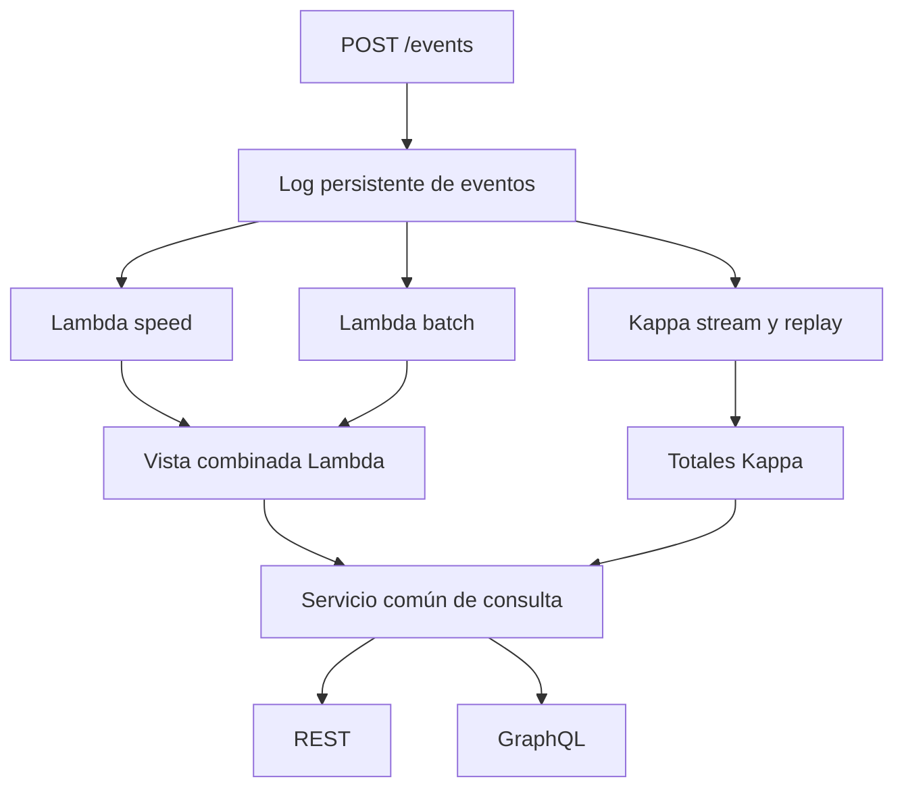

# Arquitectura del prototipo

La plataforma usa un log de eventos duradero en una tabla SQL. Es una implementación educativa de los patrones, sin Kafka, Spark ni un clúster distribuido. El propósito es comparar dos rutas de procesamiento y dos interfaces sobre el mismo dominio y motor.

## Lambda

1. Los nuevos eventos se guardan en `events` con una secuencia de llegada y un ID único.
2. La ruta rápida copia los eventos nuevos a `lambda_speed` en bloques de hasta 1000.
3. Cada umbral de 10000 posiciones, la ruta batch recalcula todos los agregados desde el log hasta un punto de corte y reemplaza `lambda_batch`.
4. En la misma transacción se retiran de speed los eventos ya cubiertos por batch y se guarda el watermark.
5. La consulta agrupa la unión de batch y speed en una sola sentencia SQL. Un snapshot de lectura observa el estado antes o después del cambio, sin mezclar la mitad de cada uno.

El prototipo ejecuta batch y speed secuencialmente dentro del consumidor para facilitar la corrección. Por tanto, batch puede pausar temporalmente la actualización rápida; no equivale a una Lambda distribuida con ramas paralelas.

## Kappa

1. Lee el mismo log por orden de llegada y procesa bloques de hasta 1000.
2. Actualiza `kappa_totals` con sumas incrementales por placa y día.
3. Guarda el último offset en la misma transacción que la proyección.
4. Para reconstruir, borra la proyección, vuelve al offset cero y ejecuta la misma función `step` sobre el log retenido.

La reconstrucción se hace con consumidores detenidos y puede dejar la vista temporalmente vacía o parcial. No hay reconstrucción paralela ni cambio atómico de versión para Kappa. Esto es un límite explícito del laboratorio.

## Consistencia y unidades

Los ID duplicados conservan el primer evento: no se duplica el gasto. Las fechas atrasadas no se descartan porque el offset representa llegada, no fecha del hecho. Las sumas usan enteros (milésimas de galón y céntimos) para evitar error acumulado de coma flotante. GraphQL expone esos dos acumulados como Float para evitar el límite Int de 32 bits; los rangos de este ensayo son enteros representables exactamente.

El consumidor y la actualización de su checkpoint comparten transacción. En PostgreSQL se bloquea la fila de checkpoint y se serializa la escritura del log mediante advisory lock para no saltar secuencias de transacciones que todavía no hayan confirmado. En SQLite se utiliza un único consumidor y la serialización de escritura del motor. La aplicación no ofrece edición ni borrado del log, aunque el usuario de base de datos sí podría alterar tablas: no se afirma inmutabilidad criptográfica.

El endpoint de ingesta confirma aceptación; las lecturas son eventualmente consistentes. Las pruebas API se hacen con vistas totalmente actualizadas y sin ingesta simultánea para aislar el coste de consulta.

## Despliegue

Docker separa `db` (PostgreSQL) y `api` (FastAPI). El contenedor `lab` ejecuta pruebas y benchmark; este último inicia su propio servidor API sin consumidores. `api` debe estar detenido mientras se ejecuta `lab` para evitar interferencias. Solo se publica el puerto API sobre 127.0.0.1. No se despliega en internet.

Las pruebas locales adjuntas usan SQLite y NO comprueban PostgreSQL ni Docker. Cambiar `DATABASE_URL` selecciona el motor con SQLAlchemy. Las sentencias SQL específicas de inicialización están diferenciadas; su integración PostgreSQL debe validarse con los comandos del README.
